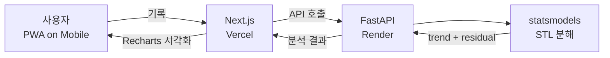

# GrowthLens — The Nudge

> 매일의 작은 변동에 흔들리지 않고, **장기 트렌드**를 보며 성장을 이어가게 해주는 습관 트래킹 PWA
> 2025년 멋쟁이사자처럼 14기 아이디어톤 출품작 — *The Nudge*

[](https://nextjs.org)
[](https://react.dev)
[](https://www.typescriptlang.org)
[](https://tailwindcss.com)
[](https://fastapi.tiangolo.com)
[](https://vercel.com)
[](https://render.com)

---

## 프로젝트 개요

작심삼일의 핵심 원인은 **일일 변동에 일희일비**하는 데 있습니다. 어제 운동을 못 했다고 좌절하기 쉽지만, 한 달 단위로 보면 운동 빈도는 상승세일 수도 있죠.

**GrowthLens**는 사용자의 습관 기록을 **STL 시계열 분해(Seasonal-Trend decomposition using Loess)** 로 분석해 **일일 변동(noise)** 과 **장기 트렌드(trend)** 를 분리해서 보여줍니다. 사용자는 단기의 흔들림이 아니라 **방향성** 을 보며 성장을 이어갈 수 있습니다.

| 항목 | 내용 |
|---|---|
| 참여 대회 | 2025년 멋쟁이사자처럼 SCH 14기 아이디어톤 |
| 아이디어 명 | The Nudge |
| 형태 | PWA (모바일 우선) |
| 본인 담당 | 풀스택 (Next.js 프론트 · FastAPI 백엔드 · 배포) |

---

## 주요 기능

### 1. 온보딩 — 목표 설정
사용자의 목표를 4단계 흐름으로 받아 맞춤형 습관 추적 환경을 구성합니다. (`/onboarding/1` ~ `/onboarding/3` + `/onboarding/goal`)

### 2. 습관 기록 (habits)
매일의 습관 수행 여부를 가볍게 기록합니다.

### 3. 인사이트 (insights)
STL 분해 결과를 **Recharts** 기반 차트로 시각화. 일일 변동을 걷어낸 **순수 트렌드** 를 보여줘 동기 부여를 유지시킵니다.

### 4. 디테일 분석 (detail / analysis)
지표별 심층 분석 뷰. 시계열 데이터를 상세하게 탐색할 수 있습니다.

### 5. PWA
홈 화면에 설치 가능, 오프라인 환경에서도 핵심 기능 사용 가능.

---

## 시스템 아키텍처



---

## API 엔드포인트

| 라우터 | 책임 |
|---|---|
| `/records` | 습관 수행 기록 CRUD |
| `/habits` | 습관 정의 관리 |
| `/analysis` | STL 시계열 분해 기반 분석 |
| `/health` | 헬스체크 |

---

## 기술 스택

| 분류 | 사용 기술 |
|---|---|
| Frontend | Next.js 15 (App Router) · React 19 · TypeScript · Tailwind CSS · Zustand (상태) · Recharts (차트) · next-pwa |
| Backend | FastAPI · Pydantic · statsmodels (STL) · numpy |
| Infra | Vercel (프론트) · Render Free (백엔드, monorepo) |
| Etc | 자체 디자인 시스템 (`stitch_growthlens_design_system/`) |

---

## 프로젝트 구조

```
.
├── app/                                # Next.js 프론트엔드
│   ├── onboarding/                     # 온보딩 (1, 2, 3, goal)
│   ├── (tabs)/
│   │   ├── habits/                     # 습관 기록
│   │   ├── insights/                   # 트렌드 인사이트
│   │   └── profile/                    # 프로필
│   ├── (detail)/
│   │   ├── analysis/                   # 상세 분석
│   │   └── insights/                   # 디테일 인사이트
│   └── layout.tsx
├── backend/                            # FastAPI 백엔드
│   ├── app/
│   │   ├── main.py                     # FastAPI 엔트리
│   │   ├── routers/                    # records / habits / analysis
│   │   ├── services/                   # STL 분해 등 서비스 레이어
│   │   ├── schemas.py                  # Pydantic 스키마
│   │   └── store.py                    # 데이터 저장소
│   ├── render.yaml                     # Render Blueprint
│   └── requirements.txt
├── components/                         # 공용 React 컴포넌트
├── lib/                                # 유틸 / API 클라이언트
├── stitch_growthlens_design_system/    # 디자인 시스템
├── middleware.ts                       # Next.js 미들웨어
└── DEPLOY.md                           # 배포 가이드
```

---

## 로컬 실행

### 프론트엔드
```bash
npm install
npm run dev
```
`.env.example` 을 `.env.local` 로 복사 후 백엔드 URL 등을 설정합니다.

### 백엔드
```bash
cd backend
pip install -r requirements.txt
uvicorn app.main:app --reload
```

자세한 배포 가이드는 [`DEPLOY.md`](./DEPLOY.md) 참고.
