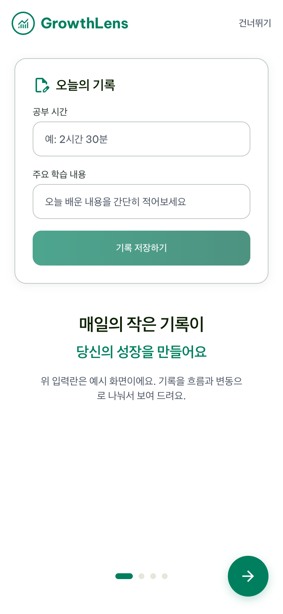
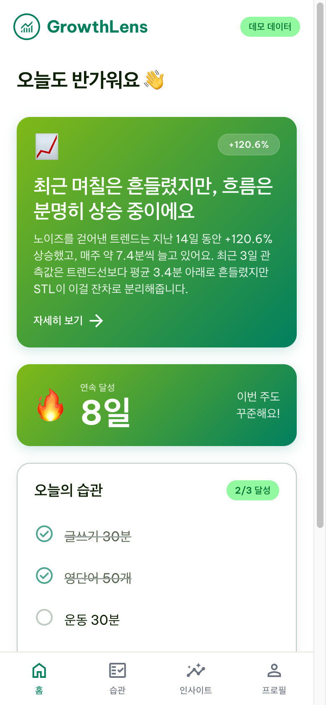
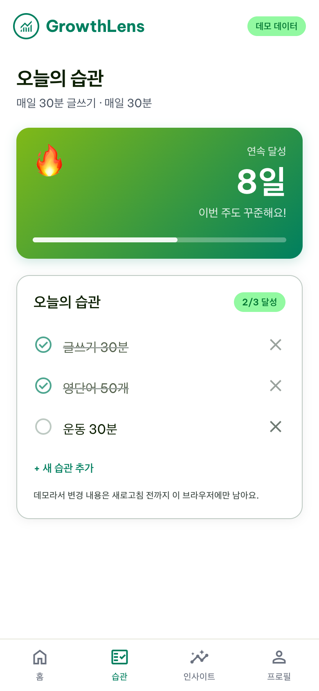
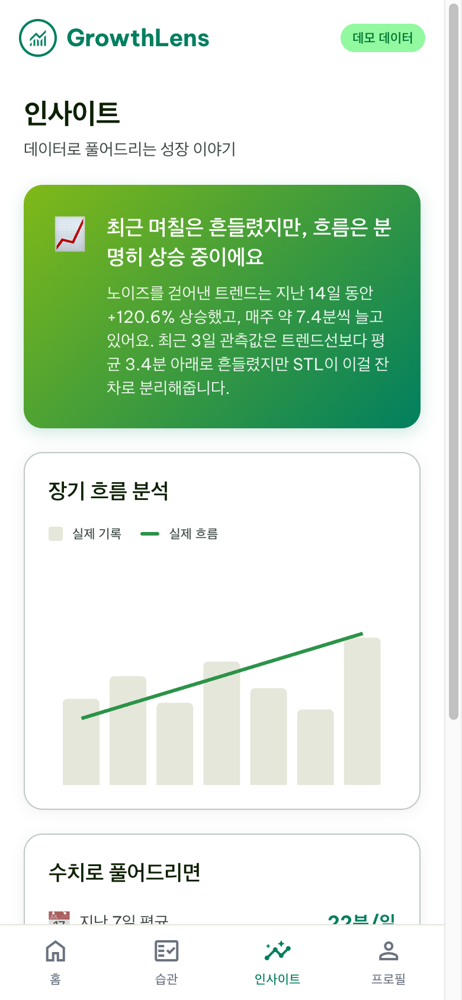
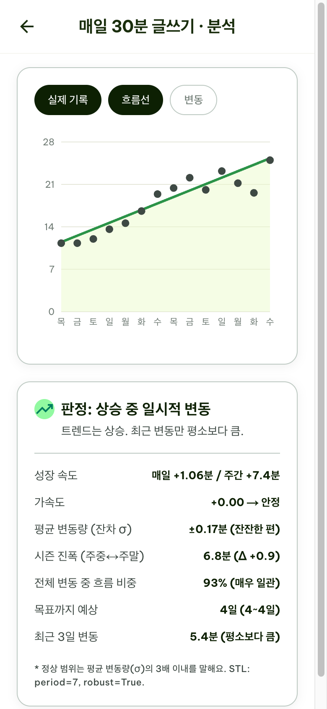
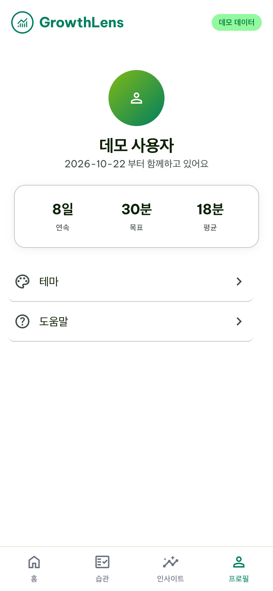
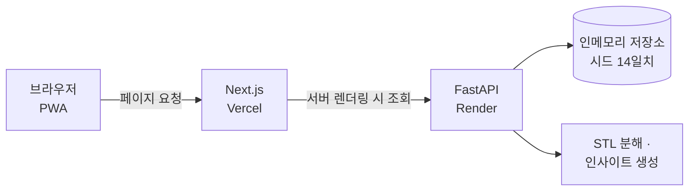

<div align="center">


# GrowthLens

**하루의 흔들림과 장기 흐름을 나눠서 보여 주는 습관 기록 PWA**

기록을 STL 시계열 분해로 나눠, 며칠의 변동보다 전체 방향을 보게 돕는 것을 목표로 합니다.

[라이브 데모](https://growthlens-ashy.vercel.app)


2026년 멋쟁이사자처럼 SCH 14기 아이디어톤 *The Nudge* · 팀 프로젝트 (본인 담당: 풀스택 구현)

</div>

> [!NOTE]
> **아이디어톤용 데모입니다.** 로그인과 DB 없이 서버 메모리에 데이터를 두며, 14일치 시드 데이터로 시작합니다.
> 공개 데모의 API는 읽기 전용이며, 습관 변경은 새로고침 전까지 해당 브라우저에만 남습니다. 화면의 수치도 시드 데이터로 계산한 값입니다.
> 백엔드가 Render Free 플랜이라 첫 접속이 오래 걸릴 수 있습니다.

---

## 목차

- [기획 배경](#기획-배경)
- [화면 구성](#화면-구성)
- [주요 기능](#주요-기능)
- [아키텍처](#아키텍처)
- [기술 스택](#기술-스택)
- [실행 방법](#실행-방법)
- [API 개요](#api-개요)
- [프로젝트 구조](#프로젝트-구조)
- [개발 현황](#개발-현황)
- [라이선스](#라이선스)

---

## 기획 배경

습관을 이어 가다 보면 하루이틀의 결과에 쉽게 흔들립니다. 어제 운동을 못 해서 좌절해도, 한 달 단위로 보면 빈도가 늘고 있을 수 있습니다. GrowthLens는 기록에서 일시적인 변동을 분리해 전체 방향을 보여 줍니다.

| 문제 | GrowthLens의 접근 |
|------|------------------|
| 며칠의 하락을 실패로 받아들임 | 기록을 **트렌드 · 주간 패턴 · 잔차**로 분해해 변동과 흐름을 나눠 표시 |
| 숫자만 봐서는 의미를 알기 어려움 | 분해 결과를 조건별 **문장형 인사이트**로 변환 |
| 지금 변동이 큰 편인지 판단하기 어려움 | 최근 3일 변동을 **평균 변동량(σ)의 3배**와 비교해 표시 |

---

## 화면 구성

<table>
  <tr>
    <td align="center" width="33%">
      <br/>
      <sub><b>온보딩</b><br/>서비스 소개와 데모 안내</sub>
    </td>
    <td align="center" width="33%">
      <br/>
      <sub><b>홈</b><br/>오늘의 인사이트 · 연속 달성 · 오늘의 습관</sub>
    </td>
    <td align="center" width="33%">
      <br/>
      <sub><b>습관</b><br/>체크 · 추가 · 삭제</sub>
    </td>
  </tr>
  <tr>
    <td align="center" width="33%">
      <br/>
      <sub><b>인사이트</b><br/>기록과 흐름선, 문장형 해설</sub>
    </td>
    <td align="center" width="33%">
      <br/>
      <sub><b>상세 분석</b><br/>STL 차트 · 판정 · 파생 지표</sub>
    </td>
    <td align="center" width="33%">
      <br/>
      <sub><b>프로필</b><br/>목표 요약</sub>
    </td>
  </tr>
</table>

> 프로덕션 빌드를 로컬에서 실행해 모바일 크기로 캡처했습니다.

---

## 주요 기능

| 기능 | 설명 |
|------|------|
| **STL 분해** | `statsmodels`의 `STL(period=7, robust=True)`로 기록을 트렌드 · 주간 패턴 · 잔차로 나눕니다. 최소 14일치 기록이 필요합니다. |
| **파생 지표** | 성장 속도, 가속도, 평균 변동량, 주중·주말 진폭, 전체 변동 중 흐름 비중, 목표 도달 예상일을 계산합니다. |
| **문장형 인사이트** | 흐름과 최근 변동을 조건으로 나눠 미리 정한 문구에 수치를 채웁니다. LLM은 사용하지 않습니다. |
| **습관 관리** | 오늘의 습관을 체크하고 추가·삭제합니다. 변경은 브라우저 메모리에만 남습니다. |
| **첫 방문 안내** | 미들웨어가 쿠키를 확인해 첫 방문자를 온보딩으로 보냅니다. |
| **PWA** | 웹 앱 매니페스트와 `next-pwa` 서비스 워커를 포함합니다. |

---

## 아키텍처



---

## 기술 스택

| 분류 | 사용 기술 |
|------|----------|
| Frontend | Next.js 15 (App Router) · React 19 · TypeScript · Tailwind CSS · Zustand · Recharts · next-pwa |
| Backend | FastAPI · Pydantic · statsmodels · NumPy · pytest |
| 배포 | Vercel (프론트엔드) · Render Free (백엔드) |
| 디자인 | `stitch_growthlens_design_system/`의 화면 시안과 디자인 규격 |

---

## 실행 방법

Python 3.12와 Node.js가 필요합니다. 터미널 두 개에서 각각 실행합니다.

```bash
# 백엔드
cd backend
python3.12 -m venv .venv
source .venv/bin/activate
pip install -r requirements.txt
uvicorn app.main:app --reload --port 8000
```

```bash
# 프론트엔드
npm install
cp .env.example .env.local
npm run dev
```

브라우저에서 http://localhost:3000 을 엽니다. 백엔드의 기본 CORS 설정이 이 주소만 허용하므로 `127.0.0.1` 대신 `localhost`로 접속합니다. API 문서는 http://localhost:8000/docs 에 있습니다.

백엔드 테스트는 다음과 같이 실행합니다.

```bash
cd backend
pip install -r requirements-dev.txt
python -m pytest
```

배포 절차는 [`DEPLOY.md`](DEPLOY.md)를 참고하세요.

---

## API 개요

| 메서드 | 경로 | 설명 |
|--------|------|------|
| GET | `/health` | 헬스체크 |
| GET | `/api/home` | 홈 화면 데이터 |
| GET | `/api/decompose` | STL 분해 결과와 파생 지표 |
| GET | `/api/insights` | 오늘의 인사이트와 지난 인사이트 |
| GET, POST | `/api/records` | 기록 조회, 날짜별 저장 |
| GET, POST | `/api/habits` | 습관 조회, 추가 |
| DELETE | `/api/habits/{id}` | 습관 삭제 |
| POST | `/api/habits/{id}/toggle` | 오늘 완료 여부 변경 |

POST와 DELETE는 기본적으로 403을 반환합니다. 로컬에서 쓰기를 허용하려면 백엔드에 `DEMO_READ_ONLY=false`를 설정합니다. 프론트엔드는 이 API들을 호출하지 않습니다.

---

## 프로젝트 구조

```
.
├── app/
│   ├── onboarding/      # 온보딩 (1, 2, 3, goal)
│   ├── (tabs)/          # 홈, 습관, 인사이트, 프로필
│   └── (detail)/        # 상세 분석, 인사이트 상세
├── backend/
│   ├── app/
│   │   ├── routers/     # analysis, habits, records
│   │   ├── services/    # STL 분해, 인사이트 생성
│   │   ├── schemas.py   # Pydantic 스키마
│   │   └── store.py     # 인메모리 저장소와 시드 데이터
│   ├── tests/           # 쓰기 차단 테스트
│   └── render.yaml      # Render Blueprint
├── components/          # 차트, 레이아웃, 온보딩 UI
├── lib/                 # API 클라이언트, 유틸
├── public/              # 아이콘, 매니페스트
├── scripts/             # 아이콘 생성
├── stitch_growthlens_design_system/  # 화면 시안, 디자인 규격
├── middleware.ts        # 첫 방문자 온보딩 이동
└── DEPLOY.md            # 배포 가이드
```

---

## 개발 현황

| 상태 | 항목 |
|------|------|
| 동작 | STL 분해와 파생 지표, 문장형 인사이트, 브라우저 내 습관 체크·추가·삭제, 첫 방문 온보딩 이동, API 쓰기 차단 |
| 예시로만 표시 | 온보딩의 기록 입력 화면, 시드에 고정된 연속 달성 일수 |
| API만 있음 | 기록 저장 (`POST /api/records`). 기본 차단 상태이며 화면과 연결되어 있지 않습니다. |
| 미구현 | 프로필의 테마·도움말 메뉴 (누르면 미구현 안내 표시) |
| 없음 | 로그인, 사용자별 데이터 분리, 영구 저장, 프론트엔드 자동 테스트, CI |

---

## 라이선스

[MIT License](LICENSE)
